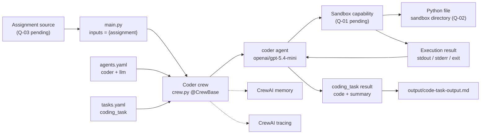
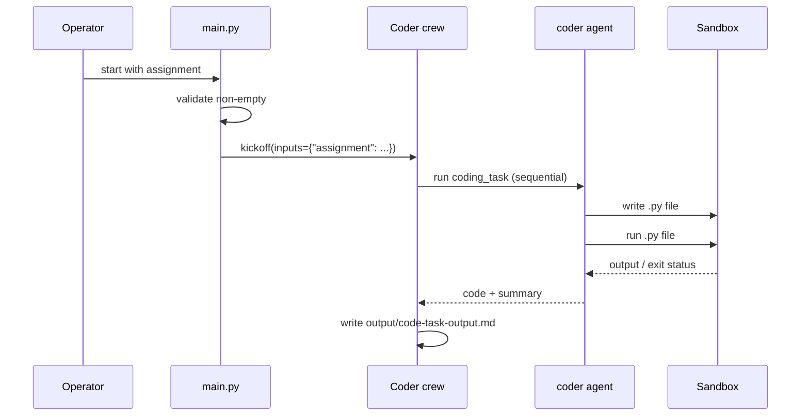

# Coder Crew Technical Implementation Plan

## 1. Technical Overview

The technical objective is to turn the existing CrewAI scaffold into the single-agent Coder Crew defined in `requirement.md`.

The proposed solution:

- Keeps the scaffold's YAML plus `@CrewBase` structure.
- Replaces the generated research example with one `coder` agent and one `coding_task`.
- Supplies a non-empty `assignment` input at kickoff.
- Gives the agent an approved sandbox capability so it can write and run a Python file.
- Writes the task result to `output/code-task-output.md`.
- Enables the required sequential process, verbose output, memory, and tracing.

This plan does not choose a sandbox mechanism or an input interface, because the business draft specifies neither. Those choices are decision gates in Phase P-01. Implementation progress and verification evidence are tracked in `tasks.md`.

### Requirements baseline

| Item | Value |
|------|-------|
| Approved requirements | FR-01, FR-02 (FR-02.1 to FR-02.5), FR-05, FR-07, FR-08 (`requirement.md`). FR-03, FR-04, FR-06 superseded by FR-02.2 to FR-02.4. |
| Acceptance criteria | AC-01, AC-FR-02-01 to AC-FR-02-06, AC-05, AC-07, AC-08 (AC-02, AC-03, AC-04, AC-06, AC-09 superseded) |
| Completed | FR-01 |
| Pending | FR-02 (YAML implemented, verification pending), FR-05, FR-07, FR-08 |
| Blocking open questions | Q-01, Q-02, Q-03, Q-04, Q-06 (implementation); Q-07, Q-08 (validation). Non-blocking: Q-05 (output format), Q-09 (entry points), Q-10 (status of FR-05, FR-07, FR-08). |

## 2. Current State Assessment

| Area | Evidence | Status | Requirements |
|------|----------|--------|--------------|
| Project scaffold | `pyproject.toml` (`[tool.crewai] type = "crew"`), `src/coder/crew.py` (`@CrewBase class Coder`), `main.py`, `config/agents.yaml`, `config/tasks.yaml`, `tools/custom_tool.py`, empty `tests/`. | Already implemented | FR-01 |
| Dependency declaration | `crewai[tools]==1.14.1`, Python `>=3.10,<3.14`. | Already implemented (declaration) | FR-01 |
| Runtime environment | Project-local `.venv` (Python 3.12.7) and `uv.lock` created by `uv sync` (uv 0.9.26); `crewai` 1.14.1 and `crewai-tools` 1.14.1 import from it (T-002, 2026-10-18). The project `.env` holds only `MODEL`; `OPENAI_API_KEY` is in the repository root `.env`. | Verified (T-002) | FR-01 |
| `agents.yaml` | Updated 2026-10-19: defines only `coder` with draft role/goal/backstory, `{assignment}`, and `llm: openai/gpt-5.4-mini`. | Implemented; verification pending | FR-02.1, FR-02.2, FR-02.5 |
| `tasks.yaml` | Updated 2026-10-19: defines only `coding_task` with `{assignment}`, `expected_output`, `agent: coder`, and `output_file: output/code-task-output.md`. | Implemented; verification pending | FR-02.3, FR-02.4, FR-02.5 |
| `crew.py` agent/task factories | Still `researcher`, `reporting_analyst`, `research_task`, `reporting_task`; `reporting_task` writes `report.md`. These no longer match the YAML keys, so `Coder()` fails until T-016. | Not implemented | FR-02 |
| Sandbox / code execution | No tools attached to any agent. `custom_tool.py` is an unused placeholder (`MyCustomTool`). | Not implemented | FR-05 |
| Assignment input | `run`, `train`, `test` pass `topic` and `current_year`. `run_with_trigger` passes `crewai_trigger_payload` plus empty `topic`/`current_year`. | Not implemented | FR-07 |
| Crew settings | `agents=self.agents`, `tasks=self.tasks`, `Process.sequential`, `verbose=True` present. `memory` and `tracing` absent. | Partially implemented | FR-08 |
| Output artifact | `output_file: output/code-task-output.md` declared in `tasks.yaml` (2026-10-19). No `output/` directory or output file exists yet; it is produced by the first run. | Configured; verification pending | FR-02.4 |
| Tests | `tests/` is empty. | Not implemented | All |
| README | Describes the generic multi-agent template and `report.md` research output. | Not implemented (stale) | — |
| `knowledge/user_preference.txt` | Scaffold sample file; not referenced by the crew. No requirement uses it. | Out of scope; leave unchanged | — |

### Reusable functionality

- `@CrewBase` class, `@agent` / `@task` / `@crew` decorators, and YAML loading.
- The existing crew constructor's `agents`, `tasks`, `process`, and `verbose` arguments.
- `main.py` entry-point functions and `pyproject.toml` script entries.
- `tools/` package location for a custom sandbox tool, if one is chosen.

### Version and documentation notes

- The pinned and installed CrewAI version is 1.14.1. T-002 (2026-10-18) recorded 1.15.28 as the latest PyPI release and the relevant changelog entries. An upgrade is not an approved requirement; the target version is decided in T-003. Per `AGENTS.md`, re-check PyPI and the changelog before writing code that depends on newer behavior.
- CrewAI 1.14.1 supports YAML agent/task configuration, `llm` in agent YAML, `output_file` in task YAML, and placeholder interpolation from `kickoff(inputs=...)`. T-002 found no changelog changes to YAML `llm` or `output_file`.
- CrewAI 1.14.0 removed `CodeInterpreterTool` and deprecated `allow_code_execution` / `code_execution_mode`; the docs recommend a dedicated sandbox. O-1 remains an option for Q-01, but it needs explicit approval (see Section 4.4). E2B and Daytona sandbox tools (candidates for O-3) arrived in 1.14.3 and would need an upgrade.

## 3. Proposed Architecture



### Execution sequence



### Component responsibilities

| Component | Responsibility | Requirements |
|-----------|----------------|--------------|
| `src/coder/config/agents.yaml` | Define only `coder` with role, goal, backstory, and `llm: openai/gpt-5.4-mini`. | FR-02.1, FR-02.2, FR-02.5 |
| `src/coder/config/tasks.yaml` | Define only `coding_task` with `{assignment}`, `agent: coder`, code-plus-summary expected output, and `output_file`. | FR-02.3, FR-02.4, FR-02.5 |
| `src/coder/crew.py` | `coder` and `coding_task` factories matching YAML keys; attach the approved sandbox capability; build the crew with the required flags. | FR-02, FR-05, FR-08 |
| Sandbox capability | Write a Python file only in the approved directory, run it within approved limits, and return the result to the agent. | FR-05 |
| `src/coder/main.py` | Get and validate `assignment` through the approved interface and pass it to every retained kickoff path. | FR-07 |
| CrewAI runtime | Model access, memory storage/embeddings, tracing. | FR-02.2, FR-08 |
| `tests/` | Configuration, wiring, input, and sandbox tests. | FR-01, FR-02, FR-05, FR-07, FR-08 |

## 4. Technical Approach

### 4.1 Keep the classic scaffold — FR-01, FR-02

Keep `@CrewBase`, `agents_config`, and `tasks_config`. Factory method names must match YAML keys exactly (`coder`, `coding_task`). Config dictionary access keeps `# type: ignore[index]`, following `AGENTS.md`.

### 4.2 FR-02: Technical Implementation Plan

#### Objective

Define the Coder Crew's single agent and single task in YAML (`requirement.md` §3.1, FR-02.1 to FR-02.5).

#### Technical Requirements

- **TR-FR-02-01: YAML keys match factory names.** The agent key `coder` and task key `coding_task` must match the `@agent` / `@task` method names in `crew.py` exactly. CrewAI 1.14.1 resolves `agent: coder` by calling the `coder` factory when the crew class is created (`crewai/project/crew_base.py`, `_map_task_variables`).
- **TR-FR-02-02: Model set in configuration only.** The model is declared in `agents.yaml` only. `crew.py` must not pass an `llm` argument.

#### Agent configuration (`src/coder/config/agents.yaml`) — FR-02.1, FR-02.2, FR-02.5

| Key | Value |
|-----|-------|
| Agent key | `coder` (only key; `researcher` and `reporting_analyst` removed) |
| `role` | Draft wording: "The role of this agent is to code. Use Python as the coding language." |
| `goal` | Draft wording, including `{assignment}`, sandbox tools, and write-then-run instructions. |
| `backstory` | Draft wording: thorough expert Python coder, well-structured and easy-to-understand code. |
| `llm` | `openai/gpt-5.4-mini` (resolved by CrewAI's `provider/model` format; needs `OPENAI_API_KEY`) |

#### Task configuration (`src/coder/config/tasks.yaml`) — FR-02.3, FR-02.4, FR-02.5

| Key | Value |
|-----|-------|
| Task key | `coding_task` (only key; `research_task` and `reporting_task` removed) |
| `description` | Draft wording, including `{assignment}` and "sandbox tools". |
| `expected_output` | "The code for the given task with a summary of what you did to achieve this assignment." No stricter format until Q-05 is answered. |
| `agent` | `coder` |
| `output_file` | `output/code-task-output.md`, set in YAML only. `crew.py` must not set its own `output_file` (this removes the scaffold's `report.md`). |

#### Assignment placeholder — FR-02.5

`{assignment}` is the only placeholder in either YAML file, so `kickoff(inputs=...)` needs only the `assignment` key. `topic` and `current_year` are no longer referenced. Supplying the value is FR-07 (T-018, T-019).

#### Dependencies

- `crew.py` still has the scaffold factories, so `Coder()` raises `KeyError: 'coder'` until T-016 adds `@agent def coder` and `@task def coding_task` (TR-FR-02-01). `crewai run` cannot work in the meantime.
- Live model access (T-025) and the sandbox tools named in the wording (FR-05, P-03) are outside FR-02.

#### Technical Validation Strategy

Deferred by the owner until a module is complete. When run:

1. Parse both files with `yaml.safe_load`; confirm one key each (`coder`, `coding_task`) and no scaffold keys.
2. Confirm non-empty `role`, `goal`, `backstory`, `description`, `expected_output`; `llm == "openai/gpt-5.4-mini"`; `agent == "coder"`; `output_file == "output/code-task-output.md"`.
3. Confirm the only placeholder in both files is `{assignment}`.
4. After T-016: `Coder()` instantiates, `crew.py` sets no `llm` or `output_file`, and interpolating a sample assignment leaves no literal `{assignment}`.
5. After the end-to-end run (T-026): `output/code-task-output.md` exists with code and summary. Check whether CrewAI 1.14.1 creates `output/` automatically; if not, create it before kickoff.

#### Decisions Requiring Approval

- Q-05: output file format (T-029).
- Q-10: status of FR-05, FR-07, FR-08 under RDDW.

### 4.3 Task and output

Merged into 4.2 on 2026-10-19.

### 4.4 Sandbox: write and run Python — FR-05

Blocked until Q-01, Q-02, Q-04, and Q-06 are answered. Options for the owner to decide:

| Option | How it works | Pros | Cons |
|--------|--------------|------|------|
| O-1: CrewAI built-in code execution | `Agent(allow_code_execution=True, code_execution_mode="safe")`; CrewAI runs code in Docker. | Least code; matches common CrewAI course examples. | Marked deprecated in CrewAI docs; needs Docker running; little control over the file path and name. |
| O-2: Custom restricted tool (`BaseTool` in `src/coder/tools/`) | A tool writes a `.py` file under the approved directory and runs it with a subprocess (list arguments, timeout). | Full control of directory, filename, timeout, and output capture; no deprecated API. | More code to own; local subprocess is not real isolation unless run in a container. |
| O-3: External sandbox service or CrewAI tool | A hosted/containerized sandbox provider, attached as a tool. | Strong isolation. | New dependency or service, credentials, and cost; needs approval. |

Whichever option is approved:

- Keep files inside the approved sandbox directory; reject path traversal.
- Run Python without building shell command strings.
- Apply the approved timeout and limits.
- Return stdout, stderr, and exit status to the agent.
- Do not use `code_execution_mode="unsafe"` (direct host execution) unless the owner explicitly approves it after reviewing the risk.

The executable `.py` file is separate from the Markdown output file (A-04).

### 4.5 Assignment input — FR-07

- Implement the interface approved in Q-03 in `main.py`.
- Reject an empty or whitespace-only `assignment` before kickoff.
- Pass `inputs={"assignment": assignment}` for `run`, and for `train`, `test`, and `run_with_trigger` if Q-09 keeps them.
- Remove `topic` and `current_year` inputs and the now-unused `datetime` import.
- `replay` takes a task ID, not inputs, so it needs no input change.

### 4.6 Crew configuration — FR-08

Build the crew with:

```python
Crew(
    agents=self.agents,
    tasks=self.tasks,
    process=Process.sequential,
    verbose=True,
    memory=True,
    tracing=True,
)
```

- `memory=True` uses CrewAI's default memory, which may use OpenAI embeddings through `OPENAI_API_KEY`. Confirm this against Q-07.
- `tracing=True` may need CrewAI login or configuration. Confirm the destination against Q-08.
- Remove commented-out code and scaffold comments from the edited sections, following `AGENTS.md` ("Never leave commented-out code in crew classes").

### 4.7 Clean up scaffold leftovers

- Remove researcher/reporting factories and `report.md` wiring.
- Replace `custom_tool.py` with the sandbox tool (O-2), or remove the placeholder if it is not used.
- Update the README so it describes the Coder Crew (P-05).
- Leave `knowledge/user_preference.txt` unchanged (no requirement uses it).
- Avoid unrelated refactoring or formatting-only changes.

## 5. Implementation Phases

| Phase | Objective | Requirements | Technical activities | Dependencies | Deliverables |
|-------|-----------|--------------|----------------------|--------------|--------------|
| P-01 — Baseline and decision gates | Confirm the runtime and get the owner decisions the draft leaves open. | FR-01, FR-02, FR-05, FR-07, FR-08 | Check installed CrewAI and `crewai-tools` versions, PyPI, and changelog (done in T-002); record decisions for Q-01 to Q-10. | Owner availability. Project `uv` environment exists (T-002). | Recorded runtime baseline and decisions. |
| P-02 — YAML configuration | Define the coder agent and coding task. | FR-02 | Rewrite `agents.yaml` and `tasks.yaml` (T-FR-02-01, T-FR-02-02); add configuration tests (T-FR-02-03). | T-001 (scaffold). Does not depend on the sandbox choice. | Coder-only YAML files; YAML tests. |
| P-03 — Sandbox capability | Let the agent write and run a Python file safely. | FR-05 | Implement the approved option (O-1/O-2/O-3); enforce limits; attach it to the `coder` agent; add tests. | Q-01, Q-02, Q-04, Q-06 decisions; Docker or provider if required. | Working sandbox capability; tests. |
| P-04 — Crew and entry-point wiring | Connect agent, task, sandbox, input, and crew flags. | FR-02, FR-07, FR-08 | Replace factories; set crew flags; implement assignment input; remove scaffold leftovers; add wiring tests. | P-02, P-03; Q-03, Q-07, Q-08, Q-09 decisions. | Runnable Coder Crew. |
| P-05 — Documentation alignment | Make operator documentation match the Coder Crew. | FR-01, FR-02, FR-05, FR-07, FR-08 | Update README: setup, credentials, assignment input, sandbox prerequisites and safety, output locations. | P-02 to P-04. | Accurate README. |
| P-06 — Validation | Show every acceptance criterion is met. | FR-01, FR-02, FR-05, FR-07, FR-08 | Lint, configuration and unit tests, model access check, one controlled end-to-end run; record evidence. | All previous phases; credentials; sandbox runtime. | Evidence for AC-01, AC-FR-02-01 to AC-FR-02-06, AC-05, AC-07, AC-08. |

## 6. Technical Dependencies

| Dependency | Purpose | Current state / action |
|------------|---------|------------------------|
| Python `>=3.10,<3.14` | Project runtime and generated code | Declared. Project `.venv` uses Python 3.12.7 (T-002). |
| `uv` | Dependency management and running commands (per `CLAUDE.md`) | Project `.venv` and `uv.lock` created with uv 0.9.26 (T-002). |
| `crewai[tools]==1.14.1` | Agents, tasks, crew, memory, tracing, tools | Pinned. `crewai` 1.14.1 and `crewai-tools` 1.14.1 installed in the project `.venv` (T-002). |
| OpenAI API (`OPENAI_API_KEY`) | `openai/gpt-5.4-mini`; possibly memory embeddings | Set in the repository root `.env`, not the project `.env` (which holds only `MODEL`). Use `--env-file ../../.env` or add the key locally. Model access to be validated (T-025). |
| Sandbox runtime | FR-05 execution | Not chosen (Q-01). O-1 needs Docker; O-3 needs a provider. |
| Memory storage / embedder | `memory=True` | CrewAI defaults; to confirm under Q-07. |
| CrewAI tracing | `tracing=True` | Destination/authentication to confirm under Q-08. |
| Test framework | Automated tests | None present. Use `pytest` if available; adding a dependency needs approval. |
| `ruff` | Lint and format (per `CLAUDE.md`) | Used in validation. |

## 7. Risks and Considerations

| Risk | Impact | Mitigation |
|------|--------|------------|
| Running model-generated code | Host compromise, data exposure, runaway processes | Block P-03 until the sandbox contract is approved; never use unsafe host execution by default. |
| Deprecated CrewAI code execution (O-1) | Future upgrades may remove it | If O-1 is chosen, record the decision and revisit before upgrading CrewAI. |
| Runtime not verified / `crewai-tools` missing | Imports or tools may fail | Resolved by T-002 (2026-10-18): project `.venv` has `crewai` and `crewai-tools` 1.14.1. |
| API key not in project `.env` | `crewai run` fails to authenticate | Pass `--env-file ../../.env` or add `OPENAI_API_KEY` to the project `.env` (not committed). |
| YAML and `crew.py` out of sync | `Coder()` raises `KeyError: 'coder'`; crew cannot start until T-016 | Expected interim state after FR-02 YAML work; complete T-016 before any run (TR-FR-02-01). |
| Version drift (1.14.1 vs newer releases) | Current docs may not match the pinned version | Implement against 1.14.1; treat upgrades as a separate decision. |
| Input interface not specified | Implementers may invent an interface | Q-03 decision before T-018. |
| Model access | `openai/gpt-5.4-mini` may be unavailable to the account | Validate access in P-06 (T-025). |
| Memory side effects | Needs embeddings; may store assignments and code across runs | Q-07 decision; document how to reset (`crewai reset-memories -a`). |
| Tracing data exposure | Prompts and code may be sent to an external service | Q-08 decision before the end-to-end run. |
| Output format ambiguity | Results may not meet unstated expectations | Meet only "code plus summary" until Q-05 is answered. |
| Agent may skip running the code | FR-05 not met even though configuration is correct | Explicit goal/description wording; AC-05 checks the run log for execution. |

### Recommendations (pending approval; not requirements)

- Prefer O-2 (custom restricted tool) or O-3 for control and isolation; choose O-1 only if Docker is available and using a deprecated API is acceptable.
- Adopt the fixed output structure in R-02 if the owner approves Q-05.
- Re-evaluate the CrewAI version pin after the pinned implementation passes validation.

## 8. Validation Strategy

Validation happens after implementation, in layers: static checks, then unit tests, then one controlled end-to-end run with a harmless assignment (for example, "print the first 10 Fibonacci numbers").

| AC | Method | Evidence |
|----|--------|----------|
| AC-01 | Inspect scaffold paths and `pyproject.toml`; import `coder.crew` in the project environment. | Path checklist; successful import. |
| AC-FR-02-01 | Parse `agents.yaml`; check one key `coder` and the role/goal/backstory content. | Configuration test. |
| AC-FR-02-02 | Check `llm` value is `openai/gpt-5.4-mini`; check `crew.py` sets no other model (TR-FR-02-02); make one controlled model call (T-025). | Configuration test; model call result. |
| AC-FR-02-03 | Parse `tasks.yaml`; check one key `coding_task`, `agent == "coder"`, and that the description contains `{assignment}` and mentions sandbox tools. | Configuration test. |
| AC-FR-02-04 | Check `expected_output` and `output_file` in YAML; after the run, check `output/code-task-output.md` contains code and a summary. | Configuration test; output file. |
| AC-FR-02-05 | Confirm no scaffold keys remain; after T-016, instantiate `Coder()` without errors (TR-FR-02-01). | Configuration test; wiring test. |
| AC-FR-02-06 | Interpolate a sample assignment and check the resolved goal and description contain it with no literal `{assignment}`. | Configuration test; run log. |
| AC-05 | Sandbox unit tests (success, non-zero exit, timeout, path traversal); end-to-end run log showing a `.py` file written and run in the sandbox directory. | Test results; run log. |
| AC-07 | Kick off with a non-empty assignment and check resolved text; check empty input is rejected before kickoff. | Input tests; run log. |
| AC-08 | Inspect crew construction for the exact flags; confirm memory and tracing start without errors during the run. | Wiring test; run log; trace evidence. |

Live validation must use non-production credentials and must not relax the approved sandbox limits.
